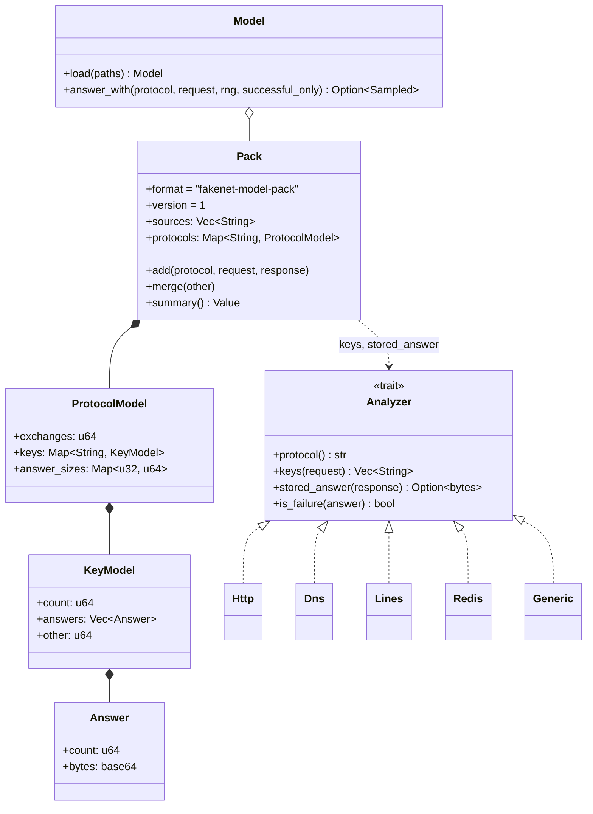
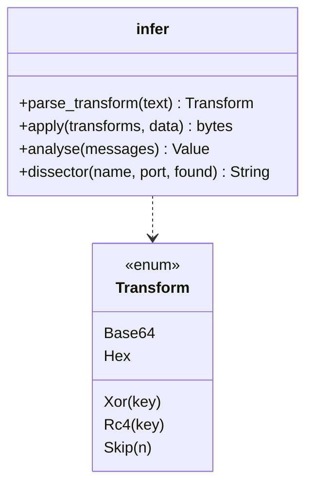

# Extension points

Everything here is meant to be extended. Skeletons: `scripts/scaffold.py`.

## Responders (nucleus/crates/listeners/src/responders.rs)

```mermaid
classDiagram
    class Responder {
        <<trait>>
        +name() str
        +respond(event: Event, default: Option~bytes~) Future~Option~Proposal~~
    }
    class Proposal {
        +response: bytes
        +close: bool
        +route: String
        +detail: Value
    }
    class ResponderConfig {
        +name: String
        +kind: ResponderKind
        +packs: Vec~Path~
        +command: Vec~String~
        +timeout_ms: u64
        +rate: f64
        +outcomes: Outcomes
        +filter: EventFilter
    }
    class ModelResponder {
        -model: Model
        -successful_only: bool
    }
    class PluginResponder {
        -command: Vec~String~
        -timeout: Duration
        +restart at most every 5 s
    }
    Responder <|.. ModelResponder
    Responder <|.. PluginResponder
    Responder ..> Proposal
    ResponderConfig ..> Responder : responders::build()
```

## Learning (nucleus/crates/model)



## Plugin protocol (JSON lines; plugins/README.md)

```mermaid
sequenceDiagram
    participant N as nucleus (PluginResponder)
    participant P as plugin process
    N->>P: start (command, no shell); stderr -> nucleus log
    loop each request offered to it
        N->>P: {"type":"respond","id":7,"protocol":"http","event":{...},"default_base64":"..."}
        alt answers in time
            P-->>N: {"id":7,"response_base64":"...","close":false,"route":"..."}
        else skips
            P-->>N: {"id":7,"skip":true}
        else too slow (timeout_ms)
            N->>N: dropped; the next responder or the default
        end
    end
```

## Transforms (nucleus/crates/cli/src/infer.rs)


