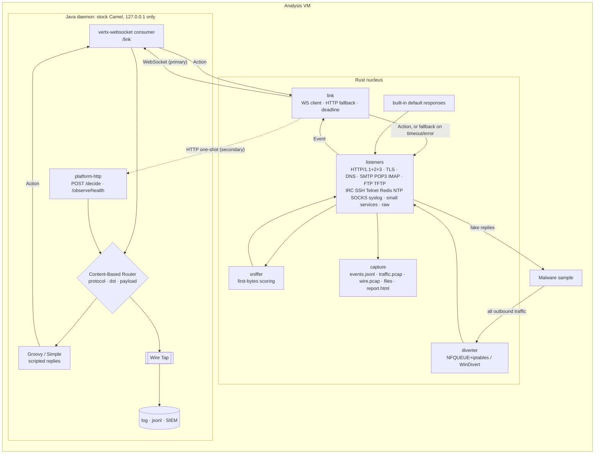

# FakeNet hybrid: architecture

A FakeNet-NG-style network simulator for isolated malware-analysis VMs, split in two:

- **Nucleus** (Rust): owns the network. Diverts all outbound traffic to local listeners,
  sniffs each connection's protocol, answers it, and records everything (JSON events, pcap,
  captured files). It works completely on its own.
- **Daemon** (Java 21, stock Apache Camel 4.18 LTS): owns the decisions. Receives each event,
  routes it (Content-Based Router), and may return a scripted response (Simple/Groovy), while
  Wire Tap fans copies out to logs or a SIEM. Routes are YAML, hot-reloaded.

## Components

| Component | Where | Responsibility |
|---|---|---|
| `schema` crate | nucleus | Event/Action types (v1), base64 payloads, session IDs. Mirrors `schema/fakenet-link-v1.schema.json`. |
| `sniffer` crate | nucleus | Scores each protocol on a connection's first bytes + destination port (FakeNet-NG's `taste()`), and picks a server-speaks-first protocol by port for silent clients. Pure, no I/O. |
| `link` crate | nucleus | `Link::decide`: asks the daemon for an Action within a deadline (default 200 ms). WebSocket client (tokio-tungstenite) with request-ID correlation and exponential-backoff reconnect; HTTP one-shot (reqwest) when the socket is down; counts decisions, fallbacks and reconnects for `/health`. |
| `listeners` crate | nucleus | tokio listeners and protocol handlers: HTTP/1.1 & HTTP/2 (hyper; proxy CONNECT and absolute-form requests), HTTP/3 (quinn + h3, sharing the same request path), TLS (rustls; certificates from rcgen for the SNI, or the destination IP / tunnel host when there's none), DNS (hickory-proto, UDP & TCP), SMTP/POP3/IMAP (STARTTLS), FTP (passive & active), TFTP, IRC, SSH (HASSH), Telnet, Redis, NTP, SOCKS4/5, syslog, echo/discard/daytime/chargen/time/qotd/finger/whois, raw TCP/UDP. The dispatcher unwraps TLS and sniffs "auto" listeners' connections and proxy/SOCKS tunnels. Each handler builds its default response (a FakeNet-NG Custom Response if one matches), asks the link (`Session::decide`/`answer`), and uses whichever wins. Per-listener process/host filters. Linux process attribution via `/proc`. Resource limits (`limits.rs`): concurrent sessions, per-source new-session rate, and a shared memory budget that every buffering handler draws from. |
| `capture` crate | nucleus | JSON-lines event log, `traffic.pcap` (synthesized, decrypted), `wire.pcap` (real packets, optional), POST bodies & uploads & emails, size-based rotation and a files budget, and the HTML report. |
| `diverter` crate | nucleus | Linux: iptables NAT REDIRECT in a dedicated `FAKENET` chain (listener ports and the FTP passive range keep their port, the rest goes to the "auto" listeners), plus an NFQUEUE hook on new connections that marks excluded processes' packets so the NAT skips them. Windows: WinDivert packet reflection (`reflect.rs`), with PIDs from WinDivert's socket layer. Restores everything on shutdown; `--restore-network` cleans up after a killed run. |
| `explorer` crate | nucleus | Response exploration for requests the daemon leaves undecided: data-driven protocol templates (`templates/default.toml`, a small slot language with encoders), hints from the sample's strings, REA's Ghidra analysis (procedures, strings, imports, segments) and the traffic itself, a UCB1 bandit per request context, hint-word weights by reward, novelty signatures for behaviour, and coverage (drcov or JSONL, by time and actor) mapped to REA's functions. Produces `explorer-map.json`. Deterministic for a seed; never sends traffic itself. |
| `cli` crate | nucleus | `fakenet-nucleus` binary: TOML config (and `--import-fakenet-ini`), link secret (`--generate-secret`), startup/shutdown, the loopback control server (authenticated `/health` and the live dashboard, strict CSP, text-only rendering), `--run` (one sample per capture folder), `--rules-from-har`, `--replay`, coverage watching for the explorer, `--report`, `--restore-network`. |
| `fuzz/` | nucleus | cargo-fuzz targets (own workspace): every protocol handler over an in-memory stream, the sniffer and parsers, diverter packet decoding, link messages, the report and the INI importer. |
| Camel daemon | daemon | `camel-main` application. YAML routes (hot reload), Content-Based Router, Groovy/Simple responses, Wire Tap, health checks, per-actor session state (`state` bean), SIEM outputs (ECS, Splunk HEC, syslog CEF via stock http/netty components), and a rules library. Only stock Camel components; our code is routes, a few processors, configuration. |

## Message flow

1. A listener reads a protocol step (an HTTP request, a DNS query, a TCP chunk) and computes
   the built-in default response first.
2. It sends an **Event** (schema v1) through the link and waits up to the deadline.
3. The daemon's router may answer with an **Action**: response bytes, close flag, delay.
   `response: null` means "use the default". The Wire Tap copies the event without delaying.
4. On timeout, a closed socket, an invalid Action, or a daemon error, the listener uses its
   default and the event log records `fallback` with the reason. The malware sees the same
   timely answer either way.

## Decisions & trade-offs

1. **The nucleus never depends on the daemon.** Defaults are computed before asking, and the
   200 ms deadline bounds the wait. *Trade-off:* a scripted reply slower than the deadline is
   lost for that request (a later one in the session can still get it). `delay_ms` exists so
   deliberate slowness doesn't count against the deadline.
2. **One WebSocket, many requests, correlated by `request_id`.** Concurrent connections share
   the socket; the nucleus matches Actions to waiting requests. *Trade-off vs one connection
   per session:* fewer sockets and a simple daemon, but correlation logic on the Rust side.
   `request_id` is an additive field beyond the brief's minimum schema.
3. **Per-protocol response encoding.** HTTP responses are raw HTTP/1.1 (Groovy templates can
   write exactly what malware expects, including odd headers), DNS responses are short text
   lines (`A 10.6.6.6`), since building DNS wire format in Groovy is error-prone. Raw/text
   protocols are sent as-is.
4. **Parsed `meta` alongside raw `payload`.** Routes can switch on `meta.host` or
   `meta.qname` without parsing bytes, while the raw payload stays available.
5. **Linux diversion = iptables NAT REDIRECT + NFQUEUE marking**, not NFQUEUE packet
   rewriting. The kernel does the NAT (robust, fast); NFQUEUE only sees each new connection's
   first packet, to mark excluded processes (the nucleus itself, whitelisted tools) so the NAT
   rule skips them. *Trade-off:* needs the `nat` table and `nfnetlink_queue`; the listeners
   recover original destinations with `SO_ORIGINAL_DST`.
6. **pcap is synthesized** from what the listeners observe (with TLS already decrypted), so
   analysts see plaintext. *Trade-off:* not a byte-exact wire capture; run tcpdump alongside
   for that.
7. **Camel stays stock.** Everything uses stock components (see below); our Java is a
   `camel-main` entry point plus small processors. Hot reload uses camel-main's built-in
   route reloading of YAML files.
8. **Lab-only exposure.** The daemon binds 127.0.0.1; the nucleus's health endpoint too.
   Listeners face the analysis network by design (that's their job), the control plane never.
   Camel's embedded servers default to 0.0.0.0, so `application.properties` pins
   `camel.server.host` and `camel.management.host`; the nucleus refuses non-loopback daemon
   URLs and health addresses at startup.
9. **Two route files, reload one.** `link.yaml` (transport) and `decisions.yaml` (rules) are
   reloaded independently (`routes-reload-remove-all-routes = false`), so saving the rules
   never drops the nucleus's WebSocket. *Trade-off:* a rule file can't redefine the link
   routes' ids.
10. **Warm up, then open the channels.** Groovy compiles each script on first use, which can
   take seconds on a cold or busy JVM and would make the first real decisions miss the
   deadline. The link routes start with `autoStartup: false`; on every (re)load of the
   rules, the `warmUp` processor compiles every Groovy script in the routes and runs one
   placeholder event per protocol through the router, then `controlbus` starts the
   channels. Until then the nucleus can't connect and uses its defaults immediately.
   *Trade-off:* scripts run once on placeholder data, so they should be free of side effects.
11. **Empty body = default.** A rule answers by setting the body; leaving it empty sends
   `response: null`, so the nucleus applies its own default. Rules only describe what's
   interesting, and a failing rule (caught in `decide-safely`) degrades to the default at once.
12. **The link is authenticated both ways.** Binding to 127.0.0.1 keeps the analysis
   network out, but malware on the same VM can reach loopback too: it could read events,
   inject decisions or, worse, take the daemon's port while it's down so the nucleus
   connects to it. With a shared secret file, each WebSocket connection starts with a
   challenge the daemon must sign (HMAC-SHA256) before any event is sent, every Event and
   Action carries an HMAC over its key fields, unsigned actions fall back to the default,
   unsigned events are dropped (HTTP: 401), and `/health` details need the secret.
   *Trade-off:* a process able to read the secret file (root/Administrator, or the daemon's
   group) defeats it, as it could anything else on the host; the HTTP channel has no
   handshake, so an impostor there sees one event per request (it still can't answer).

## Stock Camel components used (no modification)

| Need | Component |
|---|---|
| WebSocket server for the link | `camel-vertx-websocket` (consumer; replies go to the same peer via its connection key) |
| One-shot HTTP + health | `camel-platform-http-main` (embedded Vert.x HTTP server, `/observe/health`) |
| YAML routes + reload | `camel-yaml-dsl`, `camel-main` (`camel.main.routes-reload-enabled`) |
| JSON | `camel-jackson` |
| Scripted replies | `camel-groovy`, Simple (core) |
| Wire Tap, Content-Based Router | core EIPs |
| Audit sinks | `camel-file`, `camel-log` (core) |
| Warm-up, then start the channels | `camel-timer`, `camel-controlbus` |
| Concurrency off the WebSocket event loop | `camel-seda` |

Nothing in the brief needs Camel to be modified. The riskiest assumption, replying over the
stock WebSocket consumer to the peer that sent the event, holds: the consumer sets
`CamelVertxWebsocket.connectionKey`, the header survives the seda hand-off, and the
producer `vertx-websocket:127.0.0.1:8090/link` sends to that connection only (verified by
`crates/cli/tests/camel_link.rs` against the real daemon).

Camel behaviour to know when writing rules: Simple and constant expression text is trimmed
by default (use `trim: false` to keep a trailing `\n`), and Groovy `GString` results have
no Camel type converter to bytes (`ActionOut` handles any `CharSequence` itself).

## Verification status

| Part | How it's verified |
|---|---|
| Sniffer, schema, link (incl. authentication), capture (incl. rotation, report), listeners | `cargo test`: real protocol clients for every protocol, TLS/STARTTLS/HTTP/2, proxy & SOCKS tunnels, Custom Responses (FakeNet-NG's own examples and Python providers), filters, fallback when the daemon is stopped or too slow, forged actions |
| Daemon | `mvn test`: link authentication (shared HMAC vectors with the nucleus), event/action processing, the shipped rules |
| Rust–Camel link | `crates/cli/tests/camel_link.rs` against the real daemon jar: authenticated handshake, both channels, unsigned requests refused, scripted replies, hot reload without reconnecting, Wire Tap audit, kill (fallback) and restart (reconnect) |
| Daemon features | `mvn test`: session state, SIEM documents (ECS, Splunk, CEF via mock endpoints), every rules-library file loaded and exercised, the staged check-in rule |
| Fuzzing | `fuzz/run-all.sh`: all five targets run clean (millions of executions for parsers, link messages and packets). Fuzzing found and fixed: an out-of-bounds read on IPv4 headers with IHL < 5, control characters breaking the INI importer's TOML output, and a report escaping check |
| Explorer | Unit tests and a simulated bot (`tests/simulated_bot.rs`) on real REA output; `examples/explorer-demo/run-demo.sh` on a real binary analysed by REA + Ghidra: defaults reach 0 of the bot's 5 command handlers, the explorer 4, each attributed to the answer that triggered it |
| Interop | `scripts/interop.sh`: 42 checks with curl, dig, OpenSSH, redis-cli, swaks, logger, nc and Python's stdlib against the binary |
| Wire capture (Linux) | Run for real in a private network namespace (`linux_diversion` test) |
| Linux diverter | Rule generation, cleanup, NFQUEUE marking unit-tested; the end-to-end test (REDIRECT, original TCP/UDP destinations, ping, exclusions, cleanup) runs in CI as root in a private namespace. **Not run on the development machine**, whose kernel lacks the NAT modules. |
| Windows diverter | Reflection (single host, gateway, TFTP), packet rewriting, ping replies and the DNS/route scripts unit-tested on Linux; the WinDivert glue **type-checks for Windows but has not run on Windows** (CI builds and tests the rest on Windows, but can't divert a runner's own traffic). |

## Known limitations

- The synthesized `traffic.pcap` is rebuilt from what listeners see (decrypted); enable
  `wire_capture` for the real packets alongside it.
- HTTPS clients that pin certificates or don't trust the nucleus's CA (`capture/ca.pem`)
  fail the handshake; that's logged as `tls_failed`.
- Windows: the WinDivert handles last until the nucleus exits (stop = exit).
- Python Custom Response providers (HttpDynamic/TcpDynamic/UdpDynamic) are Unix-only;
  static custom responses work everywhere.

## Additional protocols worth adding later

| Protocol | Owner | Why |
|---|---|---|
| SMB (negotiate + session setup, NTLM capture) | nucleus | Binary, stateful, latency-sensitive; daemon only gets events |
| LDAP (bind + search) | nucleus parses, daemon answers | Directory replies vary per scenario: good fit for routes |
| MQTT / CoAP | daemon-scripted via raw events | IoT C2; topics/payloads are scenario-specific |
| RDP (connection request, NLA) | nucleus | Capture-only; credential capture needs CredSSP |
